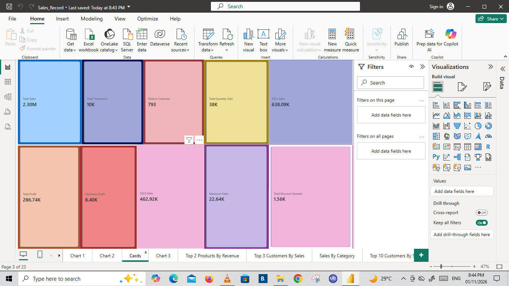
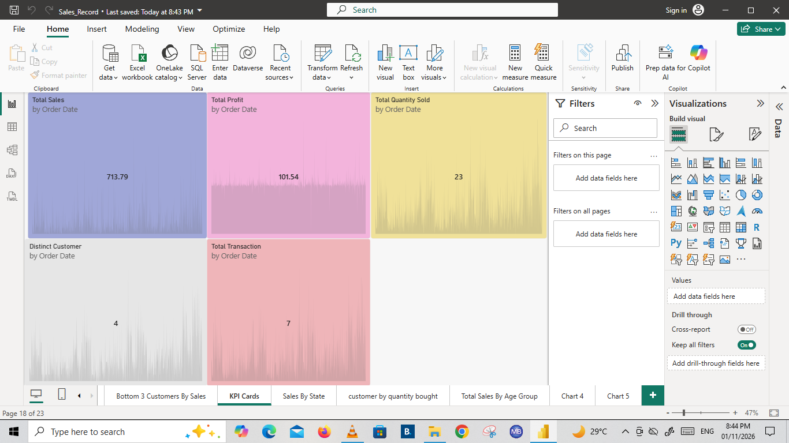

# Sales_Record
Sales Record Power BI dashboard is analysing sales, profit, product performance, and customer trends to support better business decisions.

## Project Overview 
This project involves analysing sales records using Microsoft Power BI to understand business performance. The dashboard examines sales, profit, products, customers, geographical distribution, and sales trends across different years.

This Projest was created as part of Data Analysis Portfolio to demonstrate Power BI dashboarding, data summarization and business insight skills.

---

## Business Questions Answered
- What is the total sales revenue and profit?
-Which products generate the highest sales?
-Which products generate the highest profit?
-Who are the top 10 customers by sales?
-Which customers contribute the least to sales?
-Which product category has the highest sales?
-Which cities and states generate the most sales?
-How do sales change monthly and yearly?
-Which age groups contribute most to sales?
-Which products have the highest quantities sold?

---

## Key KPIs
-Total Sales
-Total Profit
-Total Quantity Sold
-Total Transactions
-Distinct Customers
-Maximum Sales
-Maximum Profit
-Total Discount Granted
-2022 Sales
-2023 Sales

---

## Tools Used
-Microsoft Power BI Desktop
-Power Query
-DAX
-Excel/CSV

---
## Dashboard Preview

## Key Insights
-Best-performing products by sales and quantity sold.
-Customers contributing the most and least to revenue.
-Sales distribution across different product categories.
-Monthly and yearly sales and profit trends.
-Geographical differences in sales across cities and states.
-Customer purchasing patterns across different age groups.
-The relationship between product sales and profitability.

---
## Files In This Repository 
-[Sales_Record_Cards](Sales_Record_Cards_Screenshot.png)
-[Sales_Record_KPI_Cards](Sales_Record_KPI_Cards_Screenshot.png)
-[Sales_Record_Chart1](Sales_Record_Chart1_Screenshot.png)
-[Sales_Record_Chart2](Sales_Record_Chart2_Screenshot.png)
-[Sales_Record_Chart3](Sales_Record_Chart3_Screenshot.png)
-[Sales_Record_Chart4](Sales_Record_Chart4_Screenshot.png)
-[Sales_Record_Chart5_](Sales_Record_Chart5_Screenshot.png)
-README

---
## Conclusion

The project demonstrates how Power BI can transform raw sales records into meaningful business insights. It helps identify sales patterns, evaluate product and customer performance, monitor profitability, and support better business decision-making.
